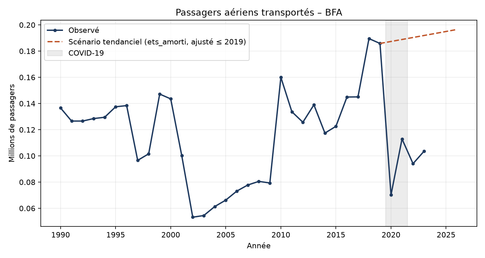
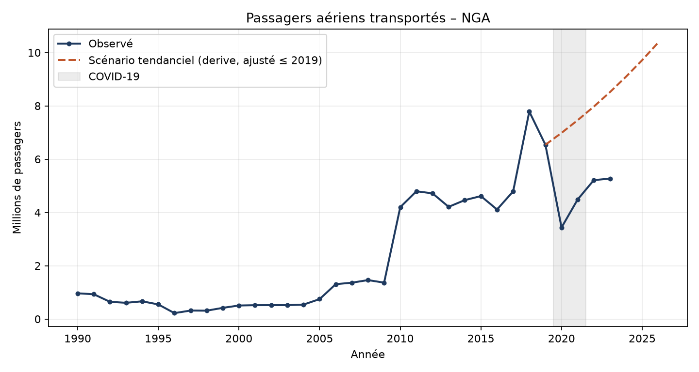
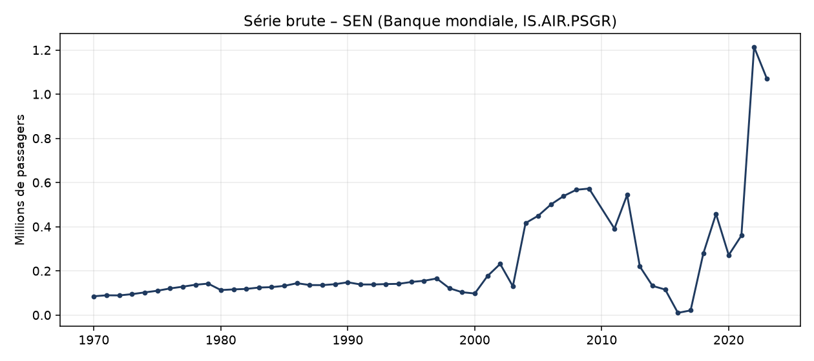

# Prévision du trafic aérien passagers – Afrique de l'Ouest

Projet d'analyse et de prévision de séries temporelles appliqué au transport aérien :
évaluer des modèles de prévision à court terme (1 et 3 ans), contrôler la qualité des séries
ouvertes et mesurer l'écart entre le trafic observé après 2019 et un scénario tendanciel (choc COVID-19).
Pays étudiés : Mali, Sénégal, Côte d'Ivoire, Burkina Faso, Niger, Ghana, Nigeria.

## Données
- **Source :** Banque mondiale, indicateur `IS.AIR.PSGR` (*Air transport, passengers carried*),
  série annuelle, élaborée à partir des données de l'OACI.
- **Téléchargement :** https://data.worldbank.org/indicator/IS.AIR.PSGR → « Download CSV »,
  puis placer le fichier dans `data/`.
- Date de téléchargement : novembre 2026

## Méthode
0. **Contrôle qualité :** séries limitées à 1990 et après ; trous de 2 ans ou moins comblés par
   interpolation log-linéaire (années comblées jamais utilisées comme cible d'évaluation) ; détection des
   ruptures (trafic multiplié ou divisé par plus de 2 d'une année à l'autre) ; seul le plus long bloc
   d'années consécutives est conservé.
1. **Modèles comparés** (estimés sur le logarithme de la série) : naïf, dérive, lissage
   exponentiel à tendance amortie (ETS), ARIMA(p,1,q) avec dérive choisi par AIC.
2. **Évaluation hors échantillon** par origine glissante (fenêtre croissante), sur la période
   précédant le COVID-19 uniquement (jusqu'à 2019), horizons 1 an et 3 ans.
   Indicateurs : MAE, RMSE, MAPE, biais.
3. **Scénario tendanciel :** le meilleur modèle (RMSE à 1 an), ajusté jusqu'en 2019, prolonge la série ;
   l'écart relatif entre l'observé et ce scénario quantifie l'effet de la crise.

## Exécution
```bash
pip install -r requirements.txt
python src/forecast.py --csv data/API_IS.AIR.PSGR_DS2_en_csv_v2_73184.csv --country MLI,SEN,CIV,BFA,NER,GHA,NGA
pytest -q tests        # tests sur données synthétiques
```
Sorties dans `outputs/<PAYS>/` : `serie_brute.png`, `evaluation_resume.csv`, `evaluation_detail.csv`,
`scenario_tendanciel.csv`, `trafic_vs_tendance.png`, et `outputs/synthese_pays.csv`.

## Résultats

**1. Qualité des données.** Sur 7 pays, 3 seulement ont assez de points continus avant 2020 pour être évalués
(Burkina Faso, Nigeria, Sénégal). Le Mali s'arrête en 2013 ; la Côte d'Ivoire, le Niger et le Ghana ont
trop de trous (moins de 16 points continus). Le Sénégal présente six ruptures (dont ×0,09 en 2016, ×13 en 2018,
×3,4 en 2022) et une erreur de plus de 100 % : sa série n'est pas interprétée.
Burkina Faso : 2 ruptures (2010 et 2020) ; Nigeria : 2 ruptures (1996 et 2010).

**2. Précision hors échantillon, horizon 1 an** (origine glissante, 15 prévisions par pays)

| Pays | Modèle | MAPE | RMSE (passagers) |
|---|---|---|---|
| Burkina Faso | naïf | 11,8 % | 26 490 |
| Burkina Faso | ETS amorti | 13,0 % | 27 080 |
| Burkina Faso | dérive | 13,2 % | 27 266 |
| Burkina Faso | ARIMA | 23,0 % | 41 570 |
| Nigeria | naïf | 18,3 % | 1 164 808 |
| Nigeria | dérive | 19,3 % | 1 180 300 |
| Nigeria | ETS amorti | 23,8 % | 1 353 147 |
| Nigeria | ARIMA | 27,3 % | 1 430 599 |

**Constat :** aucun modèle ne bat le naïf à 1 an ; à 3 ans, la dérive fait à peu près jeu égal avec le naïf
au Nigeria (RMSE 1,84 M contre 1,92 M). Les séries sont courtes et irrégulières, et un modèle simple reste difficile à battre.

**3. Écart au scénario tendanciel après 2019** (observé / tendance − 1, tendance ajustée jusqu'en 2019)

| Année | Burkina Faso (ETS amorti) | Nigeria (dérive) |
|---|---|---|
| 2020 | −62,5 % | −50,8 % |
| 2021 | −40,2 % | −39,9 % |
| 2022 | −50,6 % | −34,6 % |
| 2023 | −46,0 % | −38,1 % |






En 2023, le trafic reste inférieur de près de la moitié (Burkina Faso) et de plus d'un tiers (Nigeria) à la tendance
d'avant la crise. Ces écarts dépendent du scénario retenu ; ils décrivent un ordre de grandeur, pas une mesure causale.

## Limites
- Burkina Faso : 2018–2019 sont les années les plus hautes de la série ; l'écart de 2023 est d'environ −46 % par rapport au scénario tendanciel, mais d'environ −24 % par rapport à la moyenne 2010–2017. L'écart dépend fortement de la référence choisie.
- Série **annuelle** : peu d'observations, donc des intervalles d'erreur larges et 15 origines d'évaluation par pays.
  Pas de test de significativité (trop peu de points).
- Les données de la Banque mondiale proviennent de déclarations nationales à l'OACI ; leurs trous et ruptures
  (changements de couverture, de compagnies déclarantes ou de méthode) n'ont pas été vérifiés auprès des sources nationales.
- Seuls deux pays donnent des résultats exploitables ; les conclusions ne se généralisent pas à toute la région.
- Le scénario tendanciel n'est **pas** une prévision de l'avenir : il suppose que la tendance
  d'avant 2020 se serait poursuivie.
- Les données nationales agrégées ne distinguent ni les lignes, ni le fret, ni les mouvements d'avions.

## Pistes d'extension
Prévision du fret et des mouvements d'aéronefs, comparaison avec des pays voisins (Sénégal, Côte d'Ivoire, Burkina Faso),
prise en compte du PIB comme variable explicative.
